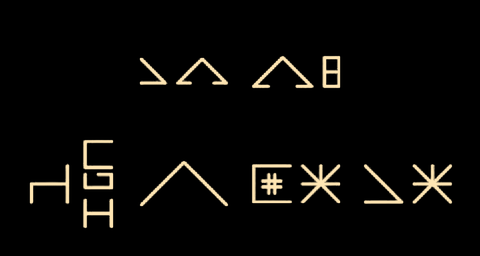

# 外星人输入法

**为《外星来信》玩家制作的 Android 输入法。**

用熟悉的词语查找外星文字，组合成自己的消息。

[下载测试版](https://github.com/JIE77777/alien-input-android/releases/tag/v0.2.0-alpha.2) · [更新记录](CHANGELOG.md) · [从源码构建](docs/build-from-source.md) · [反馈问题](https://github.com/JIE77777/alien-input-android/issues)

## 从读懂来信，到写下自己的话

在 Artless Games 的《[外星来信 / Message From Aliens](https://store.steampowered.com/app/1858720/?l=schinese)》中，玩家从未知信号出发，逐渐理解一套外星文字，以及文字背后的数字、文化与思想。

外星人输入法希望把这种书写体验带到日常聊天里。想表达一个意思时，输入中文或英文词语，挑选对应的外星字形，再把选中的词依次组合成图片。可以用它练习游戏中学到的文字，给同好写一条消息，或者试着用这些概念表达一个自己的梗。

这是玩家制作的社区工具，英文名为 **Alien Input for Android**。字形、词表与整数规则以 [feierbuqiu/alien-input v6.12.4](https://github.com/feierbuqiu/alien-input/releases/tag/v6.12.4) 为基础；日常输入依托 Trime / Rime。项目与游戏开发者没有官方隶属关系。

<details>
<summary>查看文字输出示例（涉及游戏字形）</summary>



样例展示默认米黄字、黑底，以及词组居中换行的效果。它是输入法生成的消息图片。

</details>

## 怎么用

1. 安装 APK，在 Android 系统设置中启用并选择本输入法。测试包在系统中显示为 **「外星人输入法·测试」**。
2. 平常使用九宫格输入中文，也可切换全拼或小鹤双拼；符号、数字、英文和编辑页均已接入。
3. 点键盘工具区的 **「外星」**，展开外星面板。输入拼音并确认中文词，例如「你」或「食物」，再从外星候选中选字。英文查询使用英文模式。
4. 每次点选都会加入同一份草稿。点草稿项可替换，长按可删除；继续查词，就能逐词组成一条消息。
5. 点 **「预览」** 检查排版，点 **「复制图」** 复制整张图片，再到支持图片粘贴的聊天应用中粘贴、发送。收起外星面板即可恢复普通输入。

当前采用**逐词检索、由你选择并组合**的方式。中文释义与英文别名是找字的入口，候选不代表系统已经理解整句话，也不保证组合结果符合游戏语言的语法。词表中的研究释义也不等于官方译文。

## 当前能做什么

| 功能 | 当前实现 |
| --- | --- |
| 日常输入 | Trime / Rime 基座，四叶草九宫格、全拼、小鹤双拼 |
| 词语找字 | 1344 个静态字形、2264 个字形及词组条目；中文与英文检索 |
| 消息草稿 | 连续添加、替换、删除，预览与图片复制 |
| 图片排版 | 每行最多四个字形位；优先保留词组，自动换行、逐行居中 |
| 数字表达 | 最多 18 位十进制整数，按数值转换为七进制数词；支持负数 |
| 外观 | 全套字形采用统一处理；默认米黄字／黑底，提供九组配色 |
| 可还原编码 | PNG 保存字形 ID 与词组边界，也可单独复制文字编码 |

一个词条可能占多个字形位，所以“四个字形位”不等于“四个词”。单行图片为 480×208，多行增加高度；接收应用仍可能缩放或裁切缩略图。

配色位于 **设置 → 虚拟键盘 → 外星图片配色**。默认即可使用；颜色与字形结构分开处理，呼应游戏中可以切换文字和背景颜色的方式。

## 下载与使用边界

当前版本为 **v0.2.0-alpha.2**，面向 **Android 8.0+ / arm64-v8a**，提供调试签名 APK。请从 [Release](https://github.com/JIE77777/alien-input-android/releases/tag/v0.2.0-alpha.2) 下载，并可用附带的 SHA256 文件核对完整性。

- **文字以图片输出。** 这些字形不是已经普遍支持的 Unicode 字符，接收方无需安装字体即可看图，但不能像普通文本那样自由选字。
- **图片粘贴取决于应用支持。** 微信使用「复制图」后粘贴；本工具不会代你自动发送。复制出的 `content://` URI 是本地内容引用，不是收件人可以访问的图片链接。
- **查询在本地完成。** 外星词语检索与图片生成无需联网，也不调用云端翻译服务。
- **首次尝试游戏的玩家请留意释义。** 工具会显示已整理的词义，可能提前揭示本应自己发现的内容。
- **这是早期试用版。** 已完成本机验证；多机型兼容、长期主力使用及所有聊天应用的表现仍需反馈。调试签名不同的自编译包不能保证直接覆盖安装，请保留个人词库。

PNG 中的元数据可用 `tools/read-png-message.sh` 读回；聊天压缩、转发或截图可能移除这些信息。手机端图片导入恢复尚未实现。

## 接下来做什么

优先改善输入稳定性、候选查找和消息输出，让已有能力适合持续使用；再逐步补充有来源、可核对的词义映射。

游戏原图的全量对应审核、更多数字表达与图片恢复是后续方向。完整句子翻译、Linux 和多端同步暂不属于首版范围。详见 [阶段范围](docs/checkpoint.md) 与 [探索讨论存档](docs/exploration-archive.md)。

## 开发与验证

仓库将普通输入、词义检索和图像输出分开：

- `semantic-core/`：词义检索、整数规则、组合草稿、排版与 PNG 编码。
- `android-integration/`：外星面板、候选交互、图片预览与剪贴板。
- `lexicon/`：导入词表、人工补充项与来源记录。
- `rime/`、`patches/`：输入方案与固定 Trime 版本的接入补丁。
- `tools/`、`tests/`：依赖恢复、构建与验证。

配置仓库外的 JDK 17、Android SDK、Gradle 和 Python 环境后：

```sh
python3 tools/bootstrap.py
bash tools/test-semantic.sh
bash tools/build-trime.sh
```

环境版本、路径配置和依赖下载详见 [构建文档](docs/build-from-source.md)。构建当前输入法无需安装游戏本体。

核心逻辑已通过语义、整数、PNG 编码和词组排版回归。前一构建已通过 Android 16 上的 1575 项独立检查、真实数字键盘输入和预览保稿，并完成干净源码构建。本次 alpha.2 更新应用名称与版本信息，重新构建并校验安装包；新包实机验证待补。GitHub CI 检查核心逻辑，不能替代机型与触屏验证。记录见 [本版验证](docs/four-slot-numbers-update.md)。

游戏资源解析、配色依据及待核对项保存在 [游戏研究记录](docs/game-resource-analysis.md)。生产字形采用整套上游素材统一处理；**尚未完成全部字形与游戏原始纹理的对应核实**。原始游戏文件与本地研究截图不随仓库分发。

## 致谢与许可

- **Artless Games**：《外星来信》的创作者，提供了这套文字和探索它们的游戏。
- **[feierbuqiu/alien-input](https://github.com/feierbuqiu/alien-input)**：浏览器书写工具，本项目字形、词表与整数规则的主要上游。
- **[Trime](https://github.com/osfans/trime) / [Rime](https://rime.im/)**：Android 输入法宿主与输入引擎。
- **[rime-pure](https://github.com/SivanLaai/rime-pure) / [rime-double-pinyin](https://github.com/rime/rime-double-pinyin)**：九宫格主题、四叶草资源和双拼方案。

Trime 派生宿主及整体发行遵循 **GPL-3.0-or-later**；本项目独立新增模块使用 MIT。游戏字形、文本、名称及商标仍归各自权利人所有，不纳入本项目代码授权。详见 [第三方说明](THIRD_PARTY_NOTICES.md) 与 [贡献约定](CONTRIBUTING.md)。
