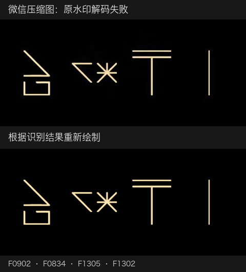

# 直接字形识别：第一轮验证

日期：2026-11-17。已完成离线原型，未接入 Android 或发布 APK。本轮没有操作手机，复用了此前真实微信发送并保存的 JPEG 文件。

## 结论

现有固定字库和排版规则足以建立有效的整字识别基线。三张微信 JPEG 都完整恢复出 `F0902 F0834 F1305 F1302`，包括此前 TrustMark P2 解码失败的文件。识别器只读取正文像素，不读取水印或消息原文；词组边界仍未知。

这支持继续优先研究字形识别，但不证明任意微信图片、游戏截图或其他字形风格都能可靠读取。

## 全字库与组合消息

模板包含全部 1344 个静态 F 字形，以及原始/统一遮罩两种风格。统一遮罩中没有逐像素完全相同的字形，但存在近似字形。每个测试输入都执行字数枚举、切字、候选匹配和整行复核，没有把正确 ID 或字数交给识别器。

| 条件 | 测试数 | 正确接受 | 不确定/拒绝 | 错误接受 |
| --- | ---: | ---: | ---: | ---: |
| 全字库，统一风格 PNG | 1344 | 1342 | 2 | 0 |
| 全字库，统一风格 JPEG75 | 1344 | 1340 | 4 | 0 |
| 全字库，统一风格缩半宽 + JPEG50 | 1344 | 1337 | 7 | 0 |
| 全字库，原始风格缩半宽 + JPEG50 | 1344 | 1336 | 8 | 0 |
| 128 条 1～4 字消息，PNG | 128 | 128 | 0 | 0 |
| 同组消息，JPEG75 | 128 | 127 | 1 | 0 |
| 同组消息，缩半宽 + JPEG50 | 128 | 125 | 3 | 0 |
| 同组消息，缩半宽 + JPEG30 | 128 | 125 | 3 | 0 |
| 已保存的真实微信 JPEG | 3 | 3 | 0 | 0 |

合计 5891 次有已知字形答案的测试：5863 次正确接受，28 次不确定/拒绝，没有错误接受。前三名中的第一候选在这些正样本中都正确，但候选太接近时仍拒绝自动确认，没有为提高通过率而降低阈值。

**这些不是 5891 条独立真实聊天样本。** 大部分是已知渲染器、已知字库的合成变换；不同条件重复使用相同字形或消息。三张微信文件也都是同一条“V我50”，分别带不同水印。它们证明原型能处理这批文件，不能换算成真实环境成功率。

66 次负样本全部拒绝：纯色 2 张、随机噪声 20 张、拉丁文本 20 张、未纳入模板的程序化数字近似渲染 24 张。负样本范围有限，未建立真实照片/截图的大规模误接受率。

## 对齐与能力边界

使用另一个固定随机种子生成 128 条消息，对比对齐改进前后。阈值保持不变，处理能力只增加标准画布坐标 ±2 像素的全局平移搜索。

| 压力条件 | 改进前正确接受 | 改进后正确接受 | 改进后拒绝 | 错误接受 |
| --- | ---: | ---: | ---: | ---: |
| 正文偏移 (+2,-2) 像素，再 JPEG65 | 1/128 | 127/128 | 1 | 0 |
| 模糊半径 1 像素，再 JPEG65 | 126/128 | 126/128 | 2 | 0 |
| 旋转 1 度，再 JPEG65 | 54/128 | 54/128 | 74 | 0 |
| 每边裁切约 5%，再 JPEG65 | 2/128 | 2/128 | 126 | 0 |
| 四边加 24 像素，再 JPEG65 | 0/128 | 0/128 | 128 | 0 |

旋转和裁切仍不可靠；没有用放宽置信门槛掩盖定位失败。错误元数据对照将“V我50”图片的 AlienInput 文本字段故意写成 F0001，识别仍返回像素对应的四个字形。

## 易混字与后续规则

详见 `confusable-glyphs.json`。例：F0033 与 F0093、F0247 与 F0840。干净原图中的相似度已很接近，压缩后更需要候选确认。这些对照可用于设计局部笔画复核，而不是仅提高全局模板得分。

当前利用的是字库、字位、字距、居中和重绘规则；没有宣称完成全部词根的几何拆解。程序化 N 数字暂不支持，也没有将其强行归入某个 F 字形。

## 性能与环境

Mac 本地 CPU，限制 BLAS 线程为 1，NumPy 2.0.2 + Pillow 11.3.0。单字常规识别中位数约 4～5 ms，混合消息约 8～9 ms，三张微信图约 9 ms；触发对齐搜索时更慢。统计不包含模板初始化、磁盘读取、Android 调用链或剪贴板读取，不能当作手机性能。

无神经模型、训练或额外下载；复用现有 Python 环境。完整逐项结果、固定种子、阈值和真实文件摘要均已留档。

## 下一步

1. 先补多行布局及程序化数字，把当前输入法已能输出的范围覆盖完整。
2. 对易混字增加局部差异检查，保留需要用户确认的候选。
3. 独立处理截图的文字区域定位、裁边和旋转，不能靠固定画布匹配冒充通用识别。
4. 再接入 Android 的“读取图片 → 字形候选 → 释义 → 放回草稿”；不确定项必须可修改。
5. 水印作为分组、版本和校验的辅助。字形序列不保证能恢复原始词组边界，更不能恢复唯一中文原句。
