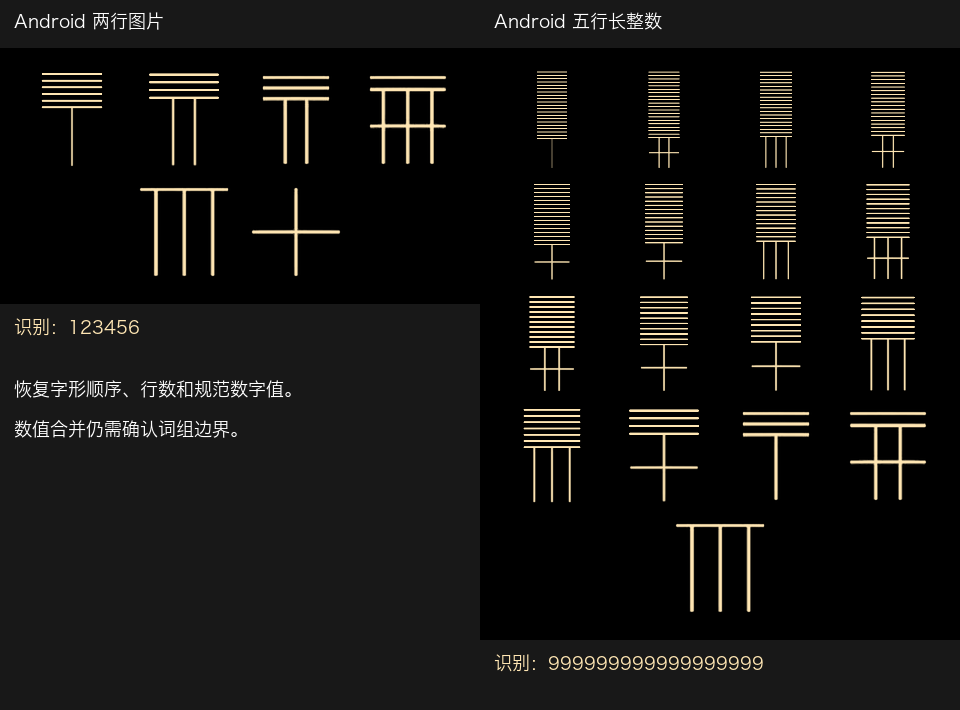

# 多行与动态数字识别验证

日期：2026-11-17。已扩展离线原型，尚未接入输入法 APK。本轮安装并运行了独立 Android 样张检查包，没有切换输入法或发送微信消息。

## 完成内容

- 按生产 ImageLayout 的尺寸、行距、字位和逐行居中规则识别多行；保留阅读顺序、每行候选及不确定状态。
- 加入全部 108 个动态数字字形 `N1P4`～`N6P21`，与 1344 个静态 F 字形共同检索。
- 动态数字分别匹配上方横线区域和下方基础数字形状，避免重复横线主导整字相似度。
- 对规范数字序列给出十进制整数候选，支持零、负数和至多 18 位十进制整数。
- 数值候选始终注明词组边界需要确认：连续“49、1”和一个“50”可能形成相同的字形序列。不会声称恢复了原始分词或原始输入。

## 样张来源

独立检查包实际调用 Android `AlienImages.glyph`、`previewDraft`、`ImageLayout` 与 `Numerals`，导出 108 个动态字形和 31 张完整消息图片。未用 Python 模拟绘制作为最终动态模板。

31 张消息涵盖不同长短行、保留词组的 2+4 换行、3+3、4+1+4、40 行/120 字形、零、1234、负数、123456、18 位整数及普通词与数字混排。manifest.json 只供评估程序核对答案；识别器接收图片，不读取答案文件、PNG 元数据或文件名来判定字形。

图片、导出代码、生产源码摘要和文件摘要全部留档。测试包只导出合成测试内容，不读取私人消息。

## 主要结果

| 测试 | 图片条件 | 正确接受 / 总数 | 不确定 | 错误接受 |
| --- | --- | ---: | ---: | ---: |
| 108 个动态字形 | PNG | 108/108 | 0 | 0 |
| 108 个动态字形 | JPEG75 | 108/108 | 0 | 0 |
| 108 个动态字形 | 缩半宽 + JPEG50 | 108/108 | 0 | 0 |
| 31 张 Android 多行/数字消息 | PNG | 31/31 | 0 | 0 |
| 31 张 Android 多行/数字消息 | JPEG75 | 31/31 | 0 | 0 |
| 31 张 Android 多行/数字消息 | 缩半宽 + JPEG50 | 31/31 | 0 | 0 |
| 全静态字库回归 | 缩半宽 + JPEG50 | 1337/1344 | 7 | 0 |

合计 1761 次主要测试，1754 次正确接受，7 次不确定，未观察到错误接受。静态字库结果与上一轮一致。

20 张已知整数消息 × 3 种图片条件，全部 60 次同时恢复了正确字形序列和十进制整数候选，包括 `-1234`、`123456` 和 `999999999999999999`。

这不是 1761 条独立真实聊天样本：字形来自已知生产渲染器，压缩是本地合成，部分内容在不同条件下重复。本轮没有新增微信传输验证，也未测量手机端识别性能。

## 数字结构复核的作用

保持普通字形匹配和整行阈值不变，在同一批 Android 模板和图片上关闭/开启数字结构复核：

| 动态数字条件 | 仅整字匹配 | 增加横线/基础数字区域复核 |
| --- | ---: | ---: |
| PNG | 86/108 | 108/108 |
| JPEG75 | 86/108 | 108/108 |
| 缩半宽 + JPEG50 | 71/108 | 108/108 |

关闭复核时，31 张消息中有两张长整数在各条件下被拒绝；开启后通过。两种方案在本批测试中都没有错误接受。提升来自增加局部结构信息，不是降低原有整体匹配门槛。

## 额外检查与实际限制

- 9 种生产配色 × 3 张消息，在缩半宽 + JPEG50 下，25/27 完整恢复，2/27 不确定，无错误接受。这是对 Android 图像做本地重着色后测试，不能冒充手机逐种配色实测。
- 两个失败项都是 `999999999999999999`，分别使用较低对比度的绿色、蓝紫色配色。原型保留拒绝，不强行输出长整数。
- 13 个纯色、噪声和不可能生产布局的对照全部拒绝。
- 合成的 48 行、120 字形上界图缩半宽后通过；Android 实际导出的最长样张是 40 行、120 字形。
- 1008 个整数编解码往返通过，另检查重复位、逆序、非法零、超范围和词组歧义。
- 裁切、明显旋转、任意聊天截图定位仍不支持。已知画布之外的图像可能拒绝，也尚未建立广泛误接受率。
- 一行不确定时不输出整条确定字形列表，仍保留逐行候选。

## 后续

识别范围已覆盖主要生产输出。下一步可以把图片读取、逐行候选确认和释义展示接入 Android，再评估真实复制粘贴路径及端侧性能。继续保留分组歧义提示；水印可补充分组信息，但不是本识别器的依赖。
