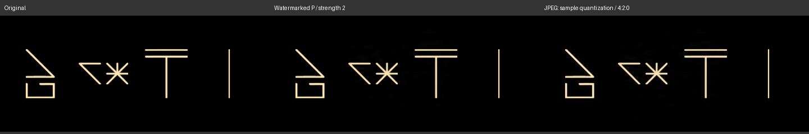

# 抗压缩水印原型：实现与验证结果

记录日期：2026-11-17。**已实现离线像素水印编解码，但现成模型在这些外星消息图片上的压缩恢复率不足，暂不接入输入法自动还原。**

## 已实现

采用 Adobe TrustMark 0.9.2，比较 Q/P 模型与多种强度。自定义 75 bit 载荷保存 1～4 个静态字形、词组边界、协议标记、版本及 CRC16，底层使用 BCH_3。模型和依赖放在仓库外，可离线运行。

解码只读取图片像素，不利用 PNG 元数据、文件名、原文缓存或服务器。结果可以转换回现有 ALIEN1 编码。超长消息、动态数字字形与其他字库版本尚不支持。

## 可独立复核的成功样例

“给／送出＋我＋50”用 P 模型、强度 2 编码，再按收到样本的 JPEG 量化表与 4:2:0 采样压缩。**全新进程只读取压缩 JPEG，完整恢复四个字形与三组边界**：

```text
ALIEN1|v6.12.4|F0902;F0834;F1305,F1302
```



[带水印 PNG](v-me-50-watermarked.png) · [压缩 JPEG](v-me-50-compressed.jpg) · [独立解码记录](independent-jpeg-decode.json)

深色背景和笔画附近有轻微残差。能否察觉受显示与缩放影响，PSNR 不能单独证明“肉眼不可见”。这张成功样例不能代表全部消息。

## 压缩参考

用户明确说明这是旧版未嵌水印的图片，仅作为压缩程度参考。收到的文件为 JPEG，480×208，3591 字节，色度采样 4:2:0。两张量化表与当前 Pillow/libjpeg 默认质量 83 的量化表完全一致。

这个匹配只描述当前文件，不能推导“微信所有场景都使用质量 83”，也不能确定交付链中每一步由谁重新编码。本实验将量化表和采样方式用于新水印图，另测半宽缩放；**没有把未加水印的旧图当作水印失败样本，也没有声称已跑过完整微信传输链路。** 用户原始文件留在本地，不随仓库提交。

## 按参考文件参数测试

八张固定样本：V我50、1/2/4 字形消息、三组固定随机字形、浅色背景。每张图都参与测试，包括基线无法恢复的样例。成功要求字形和词组边界全部一致。

| 模型 | 强度 | 原宽480＋参考JPEG参数 | 缩至240＋参考JPEG参数 | V我50原宽结果 |
| --- | ---: | ---: | ---: | --- |
| Q | 1 | 1/8 | 0/8 | 失败 |
| Q | 1.5 | 1/8 | 1/8 | 失败 |
| Q | 2 | 2/8 | 1/8 | 失败 |
| Q | 3 | 3/8 | 1/8 | 失败 |
| P | 1 | 1/8 | 0/8 | 失败 |
| P | 1.5 | 2/8 | 0/8 | 失败 |
| P | 2 | 4/8 | 0/8 | 成功 |
| P | 3 | 6/8 | 1/8 | 成功 |

共 128 次测试，没有把错误内容通过协议校验后作为成功结果输出。样本量小、内容受控，不能把零错误接受外推为通用错误率保证。

## 通用压缩矩阵

另完成 352 次测试：8 张图 × Q/P × 强度1/1.5 × 11 种变换。包含只保留像素的 PNG、JPEG质量90/75/50/30、宽360/240压缩、三轮JPEG、每侧5%裁边、24像素加边。

- PNG 基线每组成功 6～7/8；并非所有内容都能稳定编码。
- JPEG质量75时四组均只成功 0～1/8；质量50与30均为0/8。
- 宽240后质量75/50压缩，本轮四组配置均为0/8。
- 36 次未加水印负样本检测没有错误接受；352 次正样本检测没有输出通过校验的错误消息。
- 本机 CPU 4线程，编码中位数约99～129ms，解码中位数约24～27ms，不含模型初始化。这不是 Android 性能结果。

[全部通用结果](results.json) · [参考参数测试结果](sample-profile/results.json) · [外观与差异放大图](comparison.png)

## 微信机制调研

[荣耀官方支持说明](https://www.honor.com/cn/support/content/zh-cn15893063/)确认微信传图前会进行压缩，并区分普通发送与原图发送，但没有提供可作为固定规范的量化表或质量参数。

[Luban 官方仓库](https://github.com/Curzibn/Luban)的目标是复现微信朋友圈压缩策略，是第三方实现。不能直接把朋友圈复现算法或小程序压缩 API 当作当前聊天图片路径的保证。本轮未找到足以固定当前微信聊天全链路的官方编码规范，因此以收到文件的参数为测试依据。

TrustMark 的容量、纠错和强度取舍见[官方配置说明](https://github.com/adobe/trustmark/blob/main/python/CONFIG.md)。本次仅验证 75 bit/BCH_3；结果不代表所有水印算法、载荷长度或纠错配置。

## 结论与后续

当前可以演示“藏入字形编码，JPEG后恢复”的成功案例，但不足以作为自动还原的唯一来源。增强强度能改善原尺寸恢复，仍不能可靠解决缩小，因此暂不将实验功能写入已发布 APK。

继续纯水印路线时，下一步应测更小载荷与更强纠错，或针对几何文字图片设计、训练嵌入方式。结合字形识别时，可让水印只承担版本、分组和校验信息，降低容量要求。完整微信传输验证仍需对新嵌入图片进行实际往返。
