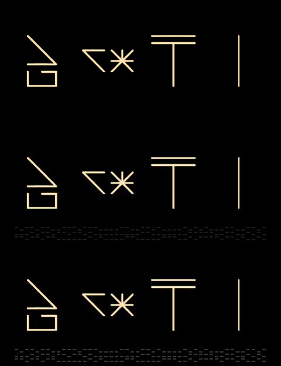

# 微信实测与低亮度短线编码

日期：2026-11-17。此实验尚未接入 Android 输入法，也未发布新版 APK。

## 结论

用户允许编码有一定可见度、但不能破坏游戏风格后，增加了底部低亮度短线编码原型。它占用原有底部留白，正文像素不变，不增加画布尺寸。相比本轮 TrustMark 神经水印，它在此次真实微信测试中更可靠；目前仍不足以宣称普遍成功率。

## 真实微信测试

手机保持旧版输入法。将独立程序生成的图片放入专用相册，在**文件传输助手**选择图片，**不勾选原图**，发送后打开并保存图片，再通过 ADB 取回文件。解码器只收到保存图片，不读取发送端缓存、原始文字、PNG 元数据或文件名映射。

| 方案 | 发送 PNG | 保存 JPEG | 尺寸 | 恢复结果 |
| --- | ---: | ---: | --- | --- |
| TrustMark P，强度 2 | 18,824 B | 6,813 B | 480×208 | 失败：无有效 ECC 水印 |
| 短线，亮度 64 | 8,884 B | 9,915 B | 480×208 | 完整恢复，0 个纠正位 |
| 短线，亮度 32 | 8,883 B | 9,030 B | 480×208 | 完整恢复，0 个纠正位 |

三份接收文件均为实际重编码的 JPEG、4:2:0，而非原始 PNG 的改名副本；摘要、量化表、逐项解码输出见 `wechat-field-results.json`。测试消息均为“V我50”：`F0902;F0834;F1305,F1302`。

TrustMark P2 此前在合成的参考 JPEG 参数测试中成功，但在这次微信保存文件上失败。这说明匹配量化表和色度采样不足以保证模拟整个真实编码链路。

这些是单台手机、同一消息、每个方案一次的测试。没有验证独立接收账号、其他平台、二次转发、复制粘贴路径或聊天截图；也没有测量普遍恢复率。

## 视觉样张

从上到下：原图、微信保存后的亮度 32 版、微信保存后的亮度 64 版。

当前更倾向以较淡版为视觉方向，但正式默认强度应保留余量并在更多内容和设备上确认。解码成功不等于视觉设计已定稿。

## 原型格式

- 仅支持 480×208、黑色背景、底部 32 像素为空的输入。发现底部已有内容时拒绝写入，避免覆盖文字。
- 将现有 75 bit 字形协议补 5 个零，成为 10 字节数据；添加 BCH(t=8, polynomial=285) 的 8 字节纠错数据，共 144 bit。
- 48 列 × 3 行，每格以短线处于上半或下半位置表示一位。正文仍居中，编码与正文之间有空隙。
- RGB 颜色由亮度参数产生暖金色暗纹。解码读取亮度差，不依赖色相、PNG 元数据或神经网络。
- BCH 层之后仍验证协议版本、字形范围、填充和 CRC16；失败不猜测字形。CRC 不是身份认证或防伪措施。
- 复用已安装 TrustMark 包中的 BCH 实现，无需加载模型权重。原型未优化 Android 依赖；未来只移植必要的纠错和像素逻辑。
- 目前只支持 1～4 个静态 F 字形和分组，不支持动态 N 字形、长消息、其他配色。此格式尚未冻结。

## 合成测试

7 组黑底消息 × 4 个亮度（32/48/64/96）× 11 种条件，共 308 次：

- PNG、JPEG 90/75/50/30、缩至宽 360 后 JPEG75、宽 240 后 JPEG75/50、三轮 JPEG：四种亮度各 63/63 次恢复，合计 252/252。
- 每边裁切 5%、四边加 24 像素：合计 0/56。固定位置解码无法处理这些情况。
- 本有限集合中没有错误接受的消息；77 次无编码对照均未接受。
- 额外进行 180 次 BCH 注入错误检查，每次随机改动 0～8 位，均恢复原始数据。

完整结果见 `footer-results.json`。这些数字是小规模合成测试，不能外推成微信成功率。更强缩小、模糊、裁切、截图以及其他配色仍可能失败；底纹被裁掉后不能靠这条通道恢复。

## 后续收敛方向

1. 优先完善这条低亮度几何编码通道，保持正文风格、固定占用边距。
2. 扩充至其他配色、多行、动态数字，并设计定位信息；先解决格式容量和同步，再考虑正式协议。
3. 保留 PNG 元数据作为无损路径；后续字形识别可处理旧图及没有编码的图。两者与底纹互补。
4. 暂不叠加神经水印：本轮没有证据证明它能带来足够收益。
5. 再接入“读取剪贴板图片 → 解码 → 展示字形/释义 → 放回草稿”。此轮尚未实现该 Android 界面。
